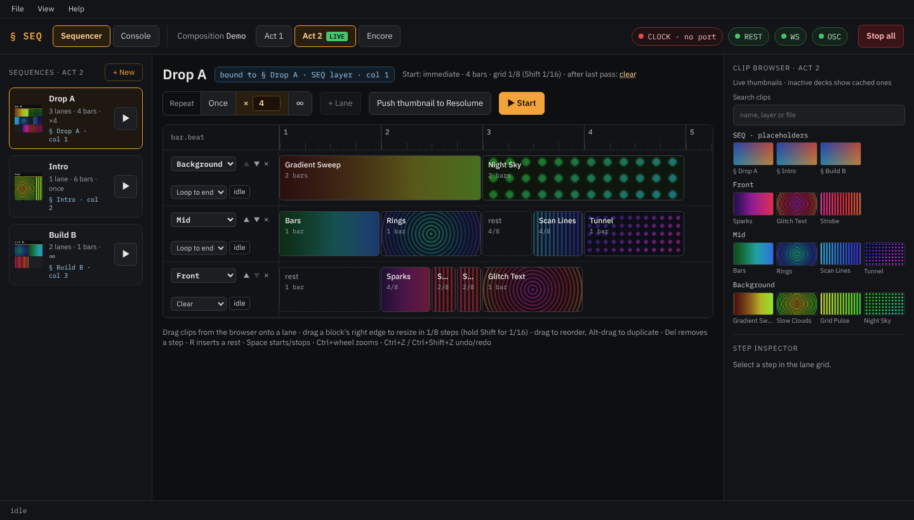

# Clip Sequencer for Resolume

**[Website](https://ghostrider.github.io/clip-sequencer/) · [User manual](https://ghostrider.github.io/clip-sequencer/manual/) ·
[Download](https://github.com/ghostrider/clip-sequencer/releases/latest) · [Changelog](CHANGELOG.md)**

Plays multi-layer clip sequences in Resolume Arena, locked to the show's MIDI clock. You build sequences
(clips and rests on lanes, one lane per layer, on a 1/16-bar grid) in the app and start them from the app or from
Resolume itself by clicking a `§` placeholder clip. Clips are triggered over OSC exactly on the tick, and the
app follows Resolume over its WebSocket and REST API.



*Using the app? Read the [user manual](https://ghostrider.github.io/clip-sequencer/manual/). This README is for
getting started and for building from source.*

## Features

- Lanes per Resolume layer with clips and rests on a 1/8 or 1/16-bar grid; repeat once, ×N or endlessly.
- Locked to an incoming MIDI clock; triggers are confirmed over Resolume's WebSocket.
- Start and stop from the app or from Resolume (`§ <name>` clips on a `SEQ` layer); manual clip clicks
  take over a lane until you resume it.
- Works per deck, follows renames, re-finds clips by id, name or file.
- Desktop app (one window, splash, live Console tab) and a headless mode with the UI in a browser.
- Optional FFGL source plugin "1000A Sequence" ([`ffgl/`](ffgl/README.md)) that shows the sequence timeline
  on the `§` clip in Resolume; it ships in the zip and is installed from the app (**File → Install FFGL plugin…**).

## Requirements

- Windows 10 or 11, on the same machine as Resolume.
- Resolume Arena 7.26 or newer (tested with 7.28), with the webserver and OSC input enabled (see below).
- A MIDI clock on a MIDI input port, e.g. from a virtual MIDI port such as loopMIDI, a DAW, a hardware
  clock, or a separate clock app. On Windows the app can't create virtual ports itself; it connects to an
  existing port by name.
- The desktop app (`seq-app.exe`) needs the **Microsoft Edge WebView2 Runtime**. It ships with Windows 11. On
  Windows 10 without it, the app says so and offers the
  [download page](https://developer.microsoft.com/microsoft-edge/webview2/) ("Evergreen" runtime).
  `seq-app-cli.exe` doesn't need it.

## Install

1. Download `clip-sequencer-<version>-windows-x64.zip` from the
   [latest release](https://github.com/ghostrider/clip-sequencer/releases/latest).
2. Optional: check it against `SHA256SUMS.txt` from the same release:
   `Get-FileHash clip-sequencer-<version>-windows-x64.zip -Algorithm SHA256`.
3. Unzip it anywhere (nothing is installed) and double-click `seq-app.exe`.

The executables are not code-signed, so Windows SmartScreen may warn the first time ("Windows protected your
PC"). Click **More info → Run anyway**. Settings and sequences live in `%APPDATA%\resolume-sequencer`, not in
the unzipped folder, so a new version can be unzipped next to the old one.

## Resolume setup (once per composition)

1. **Preferences → Webserver:** enable *Webserver & REST API*, port `8080`.
2. **Preferences → OSC:** enable *OSC Input*, port `7000`.
3. **Composition → Clip Beat Snap: None.** Triggers are sent exactly on the tick; snapping would
   delay them.
4. **Name your layers** (e.g. `BG`, `MID`, `FX`). Lanes target layers by exact, unique name.
   Resolume *displays* unnamed layers as "Layer 1", "Layer 2", … but reports them all as
   `Layer #`, so they can't be used until renamed (double-click the layer name, or right-click →
   Rename). Renames are picked up live.
5. **Starting from Resolume (optional):** add a layer named `SEQ`. For each sequence, put a clip
   with the *Blank* source (or the "1000A Sequence" plugin) on it and name it `§ <sequence name>`
   (e.g. `§ Drop A`). Clicking the clip starts the sequence of that name in the live deck; disconnecting it
   (or clearing the layer) stops it. Set the SEQ layer's opacity to 0 if the placeholders should never be
   visible.

## Run

### Desktop app

Double-click **`seq-app.exe`** (in the unzipped folder, or `release\` after building).
- A splash screen shows the startup steps. A missing Resolume or MIDI port only gives a warning; the
  sequencer keeps retrying in the background.
- Then the window opens with the UI.
- The first time, pick the MIDI clock input under **File → Preferences…** (or click the CLOCK chip,
  or press Ctrl+,). It's saved and used on every start.

Menu:
- **File:** Reload composition, Save now, Open data folder, Preferences…, Quit (Ctrl+Q).
- **View:** zoom (Ctrl+= / Ctrl+- / Ctrl+0) and Toggle Console.
- **Help:** Keyboard shortcuts, User manual, Report an issue (both open in the browser), Licenses, About.

Closing the window while a sequence runs asks first. Then the sequences end as configured (layers
cleared or held) before the app exits. The window size and position are remembered. Starting
`seq-app.exe` a second time doesn't start a second sequencer: it offers to bring the running one to
the front.

The same options as below work on the command line (e.g. `seq-app.exe --midi-port "loopMIDI Port"`
overrides the saved port for that run). `--no-splash` opens the window without the splash.

### Headless (console, UI in a browser)

```powershell
seq-app-cli.exe --midi-port "loopMIDI Port"
```

It prints the startup steps and then the UI address, normally **http://127.0.0.1:8090**; open it in
a browser. Ctrl+C (or closing the console window) stops the sequencer: running sequences end as
configured, then it exits. In the browser the UI has a menu bar (File, View, Help; Alt or F10 opens it), and
**File → Quit server…** stops the sequencer the same way.

### UI port

The UI uses port `8090` (`--ui-port`). If another program has it, the sequencer takes the next free
port from 8091 to 8099, then one the OS assigns. It logs a warning, and the desktop window and
console output use the actual address. `--strict-port` exits with an error instead of falling back.
If the port belongs to a running sequencer, no second one starts. The running instance's address is
written to `%APPDATA%\resolume-sequencer\runtime.json` (`pid`, `ui_url`, `started_at`) while it runs.

### Options

Useful options (`--help` lists all):

| Option | Default | |
|---|---|---|
| `--midi-port <name>` | saved in Preferences | MIDI clock input (exact name or a substring) |
| `--resolume-host`, `--rest-port`, `--osc-port` | `127.0.0.1`, `8080`, `7000` | Where Resolume listens |
| `--ui-port` | `8090` | UI port (falls back, see above) |
| `--strict-port` | | Don't fall back if the UI port is taken |
| `--no-splash` | | Desktop app: no splash screen |
| `--seq-layer`, `--seq-prefix` | `SEQ`, `"§ "` | Placeholder layer and clip-name prefix |
| `--data-dir` | `%APPDATA%\resolume-sequencer` | Sequence files, settings, logs, thumbnail and deck caches |
| `--list-midi-ports` | | Print MIDI input ports and exit (`seq-app-cli.exe`) |
| `--clock-debug` | | Show the incoming clock (bar.beat.tick, BPM) to check the port (`seq-app-cli.exe`) |
| `--validate <file>` | | Check a `.seq.json` file and exit (`seq-app-cli.exe`) |

### Logs

- **Files:** daily log files in `%APPDATA%\resolume-sequencer\logs\` (`seq-app-YYYY-MM-DD.log`). They
  are kept for 7 days.
- **Console tab:** shows the log live (Ctrl+2), with level filters, pause, copy and save. In the
  desktop app, it opens with View → Toggle Console.
- **Headless:** `seq-app-cli.exe` also prints the log to the console.
- **More detail:** set `RUST_LOG=debug` to see every OSC message with microsecond timestamps.

### Before a show

1. Start Resolume (composition open), then your MIDI clock source, then `seq-app`.
2. Check the chips in the UI's top bar: **CLOCK** shows the BPM and "locked", **REST**, **WS**,
   **OSC** are green.
3. Make every deck you will use live once: its clips are then cached, so its sequences show and
   resolve even while another deck is live (also after a restart).

## Using it

- **Deck tabs** show a deck's sequences; **LIVE** marks Resolume's active deck. Viewing a tab never
  switches Resolume. Starting a sequence of another deck asks first, stops what is running,
  switches the deck, then starts.
- **Sequences:** `+ New`, right-click for rename / duplicate / delete. Sequences of decks that no
  longer exist are listed under their old deck name; move them with right-click.
- **Editor:** drag clips from the browser onto a lane; drag a block's right edge to resize (1/8
  bar steps, hold `Shift` for 1/16); drag to reorder, Alt-drag to duplicate; `Del` removes, `R` inserts a rest,
  `Space` starts/stops, `Esc` deselects, `Ctrl+Z` / `Ctrl+Shift+Z` undo/redo, `Ctrl+wheel` zooms.
- **Rests** clear the layer (it shows nothing; layers below show through). If the lane's clip
  lives on another layer (⚠ on the step) and is still playing, that layer is cleared too.
- **Lanes** can be reordered with ▲ / ▼ on the lane head. **Red steps** are unresolved (clip not found): they trigger nothing.
  The step inspector shows which of clip id / name / file still match and offers *Relink*.
- **Lane ends** (when a lane is shorter than the sequence): *Loop to end*, *Hold* (last clip keeps
  playing), *Clear*. **Repeat:** once, ×N or ∞; after the last pass the layers are cleared or held.
- **Manual override:** clicking a clip in Resolume on a layer a sequence owns makes that lane
  *yielded* — it keeps counting but stops triggering until *Resume lane*.
- **Edits while running** apply at the next start ("edited · applies at next start").
- **Push thumbnail to Resolume** sets the sequence's mosaic as its `§` clip's thumbnail.
- **Stop all** clears every layer the sequencer owns.

Sequences are saved automatically (about 1 s after an edit) to
`%APPDATA%\resolume-sequencer\<Composition>.seq.json`.

## Behaviour worth knowing

- No clock → sequences freeze in place (top bar shows "no clock") and continue when it returns.
  MIDI Start (e.g. a clock source's resync) does not restart sequences.
- If Resolume quits, triggers are not confirmed (red top edge on steps); when it comes back the
  sequencer reconnects by itself. A port that disappears (clock source restarted) is reconnected
  automatically too.
- Switching decks in Resolume by hand stops running sequences without clearing anything.
- A sequence started from its `§` clip clears the SEQ layer when it finishes, so the next click
  starts it again.
- Start a sequence from one place at a time. Starting it from the UI while its `§` clip is
  connected restarts it from step 1 as a UI start: clearing the SEQ layer then no longer stops it,
  and clicking the `§` clip does nothing until the layer is cleared (known limitation, SPEC §7.1).

## Security

The UI server listens on `127.0.0.1` only, so the UI and its API are reachable from this computer and nowhere
else; there is no option to open it to the network. It has no login: anything running on the machine can use
it, like Resolume's own webserver. To report a vulnerability, see [SECURITY.md](SECURITY.md).

## Building from source

Needs Windows, [Rust](https://rustup.rs/) (stable, MSVC toolchain), Node.js 20.19+ or 22.12+, and for the
third-party notices of a release `cargo-about` (`cargo install --locked cargo-about --features cli`).
The FFGL plugin needs Visual Studio 2022 (C++ desktop workload).

```powershell
git clone --recurse-submodules https://github.com/ghostrider/clip-sequencer
cd clip-sequencer
powershell -ExecutionPolicy Bypass -File scripts\release.ps1
```

`release.ps1` builds the UI (`web/`), the third-party notices, the FFGL plugin and the release binaries. It puts
`seq-app.exe` (desktop app, no console) and `seq-app-cli.exe` (console: headless, `--validate`,
`--list-midi-ports`, `--clock-debug`, `--install-ffgl`) in `release\`, together with the portable zip (both
executables, `ffgl\SeqView.dll` and the license files) and its `.sha256`. Both executables contain the UI.

Development (checks, mock Resolume, hot reload, test clock):

```powershell
powershell -ExecutionPolicy Bypass -File scripts\check.ps1      # versions, fmt, clippy, tests, cargo deny
cargo run -p mock-resolume -- --rest-port 8080 --osc-port 7000   # fake Resolume
cd web; npm install; npm run dev                                 # UI with hot reload (app on :8090)
$env:SEQ_DEV_URL='http://localhost:5173'; cargo run -p seq-app   # desktop window on the hot-reload UI
cargo run --release -p clock-in --example clock_gen -- "Default App Loopback (A)" 128   # test clock
cargo run --release -p seq-app --example soak -- "Default App Loopback (B)" 120          # long-run test
powershell -ExecutionPolicy Bypass -File ffgl\build.ps1 -Tests  # FFGL plugin and its tests (no install)
powershell -ExecutionPolicy Bypass -File ffgl\build_seqview.ps1  # FFGL plugin: build + copy to Resolume
```

The desktop shell (Tauri v2) is built by plain `cargo build`; the Tauri CLI isn't needed. Debug builds read
`web/dist` from disk (so `npm run build` and a reload show UI changes); release builds embed it.
`SEQ_DEV_URL` (debug builds only) points the window at the Vite dev server. For WebView2 DevTools set
`WEBVIEW2_ADDITIONAL_BROWSER_ARGUMENTS=--remote-debugging-port=9223`.

Design and internals: [`docs/SPEC.md`](docs/SPEC.md) (concept and behaviour),
[`docs/resolume-api-notes.md`](docs/resolume-api-notes.md) (what the Resolume API really does),
[`CLAUDE.md`](CLAUDE.md) (layout and commands). How to contribute: [CONTRIBUTING.md](CONTRIBUTING.md).

## License

MIT, see [LICENSE](LICENSE). Copyright (c) 2026 Ulrich Staudinger.
Third-party components and their licenses are listed in the app (Help → Licenses) and in
`THIRD_PARTY_LICENSES.md` in the release zip; the IBM Plex fonts are under the SIL Open Font License
([OFL.txt](OFL.txt)).

Provided as is, without warranty of any kind. Not affiliated with or endorsed by Resolume BV. Resolume is a
trademark of Resolume BV.
