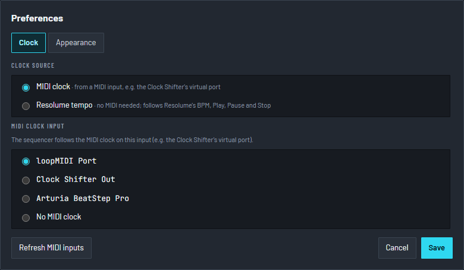
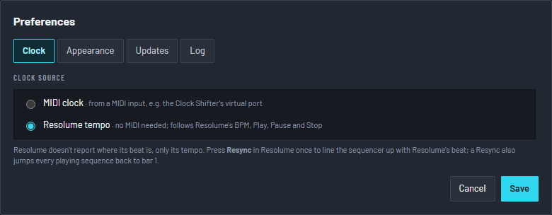
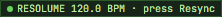
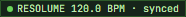

# Setting up the clock

The sequencer moves its sequences forward on a clock of 24 pulses per beat. Without a clock, nothing advances. It
takes that clock from one of two sources:

- **MIDI clock** (the default): it counts the MIDI clock on a MIDI input.
- **Resolume tempo**: no MIDI needed. The sequencer makes its own clock at Resolume's BPM and follows its Play,
  Pause, Stop and Resync.

## Which one to use

**Use the MIDI clock when your show already has one**, from a DAW, a clock or BPM-detection tool, or hardware, and
Resolume follows that clock too. Both then get the same pulses, so the sequencer is on the beat from the first
pulse, keeps it through restarts, and you can delay the clock for projector latency.

**Use Resolume tempo when there is no MIDI clock**: you set the tempo in Resolume itself, by typing the BPM or
tapping. Nothing else to install or connect. The catch: Resolume tells the sequencer its tempo, but not where its
beat is, so you press **Resync** in Resolume once to line the two up.

| | MIDI clock | Resolume tempo |
|---|---|---|
| Needs | a MIDI clock source and a MIDI input (often a virtual port such as loopMIDI) | nothing but Resolume |
| Tempo comes from | the clock source | Resolume's BPM (typed, dragged or tapped) |
| On the beat | always, from the first pulse | after you press **Resync** in Resolume; again after a reconnect |
| Resolume's Resync | doesn't touch running sequences | jumps every playing sequence back to bar 1 |
| Resolume's Pause / Stop | ignored by the sequencer | freezes running sequences |
| Latency compensation | yes: delay the clock for both | no |
| Good for | shows with a DAW or a band clock, tight sync to music | quick setups, rehearsal, VJ sets on Resolume's own tempo |

If Resolume itself follows an external clock, give the sequencer that same clock as **MIDI clock**: following
Resolume's tempo would only copy the BPM, not the beat.

## Choosing the source

Open **File → Preferences…** and the **Clock** tab (or click the clock chip in the status bar at the bottom, or press Ctrl+,). Pick
the source under **Clock source**, then click **Save**. The sequencer switches at once and remembers it for the
next start. For one run, `--clock midi` or `--clock resolume` on the command line wins over the saved choice
([Settings](settings.md)).

## MIDI clock

Anything that sends MIDI clock to a MIDI input on the Resolume computer works:

- a DAW or another app, through a **virtual MIDI port** (for example loopMIDI);
- a hardware clock or MIDI interface;
- a tool that derives the clock from the music (BPM detection) or shifts it.

On Windows the sequencer can't create a virtual port itself: it connects to an existing input by name. Start the
clock source (or create the virtual port) before choosing it.

Resolume and the sequencer must both receive **the same MIDI clock**, so Resolume's tempo and the sequencer's
steps agree.

#### Projector latency

If you delay the clock to make up for projector or LED processor latency, give the sequencer the **same
shifted clock** as Resolume. The sequencer never compensates latency itself; it triggers on the clock it gets.

### Choosing the MIDI input

1. Open **File → Preferences…** (or click the **CLOCK** chip in the status bar at the bottom, or press Ctrl+,).
2. Under **Clock source**, choose **MIDI clock**.
3. Pick the input under *MIDI clock input*. **Refresh MIDI inputs** lists the ports again if you just started the
   source.
4. Click **Save**.

The sequencer switches at once and remembers the input for the next start. *No MIDI clock* switches the input off.

For one run you can also start the app with `--midi-port "<name>"`. A part of the name is enough
(`--midi-port loopMIDI`). It wins over the saved choice for that run ([Settings](settings.md)).

### Checking it

The **CLOCK** chip in the status bar at the bottom shows the state:

| Chip | Meaning |
|---|---|
| `CLOCK 128.0 BPM · locked` (green) | Ticks arrive; the BPM is measured from them. |
| `CLOCK · no clock` (red) | The input is open, but no ticks arrive. Start the clock source. |
| `CLOCK · no port` (red) | No input selected, or the port isn't there (yet). The sequencer keeps trying. |

From the console, `seq-app-cli.exe --clock-debug --midi-port "<name>"` shows the incoming clock (bar.beat.tick and
BPM), and `seq-app-cli.exe --list-midi-ports` lists the inputs.

## Following Resolume's tempo

With **Resolume tempo** as the source, the sequencer needs no MIDI at all. It reads Resolume's BPM and transport
over the connection it already has, and makes its own clock at that tempo.

### Switching to Resolume tempo

1. Open **File → Preferences…** (or click the clock chip in the status bar at the bottom, or press Ctrl+,).
2. Under **Clock source**, choose **Resolume tempo**. The MIDI input list disappears; your MIDI input stays saved
   for switching back.
3. Click **Save**. The clock chip now reads **RESOLUME** with Resolume's BPM.
4. In Resolume, press **Resync** in the tempo controls, next to the BPM. The chip changes from
   *press Resync* to *synced*.

| Before the Resync | After it |
|---|---|
|  |  |

### What Resolume's controls do

Resolume tells the sequencer its tempo, but **not where its beat is**. So the sequencer's beat runs at the right
speed, but at first it can sit up to half a beat off Resolume's. To line the two up, press **Resync** in
Resolume's tempo controls once: that moment becomes beat 1 for both.

| In Resolume | The sequencer |
|---|---|
| Change the BPM (type, drag, tap) | follows at once. |
| **Resync** | lines up with Resolume's beat, and **every playing sequence jumps back to bar 1**. |
| **Pause** | freezes running sequences where they are. |
| **Play** after Pause | continues from there. |
| **Stop** | freezes running sequences. |
| **Play** after Stop | counts as a Resync: lines up, playing sequences start again at bar 1. |

### Checking it

The clock chip shows:

| Chip | Meaning |
|---|---|
| `RESOLUME 128.0 BPM · synced` (green) | Running and lined up with Resolume's beat. |
| `RESOLUME 128.0 BPM · press Resync` (green) | Running at Resolume's tempo, not lined up yet. Press Resync in Resolume. |
| `RESOLUME 128.0 BPM · paused` / `· stopped` (red) | Resolume's transport is paused or stopped; sequences wait. |
| `RESOLUME TEMPO · not connected` (red) | No connection to Resolume; nothing advances. After it reconnects, press Resync again. |

### Good to know

- A Resync restarts *every* playing sequence, also one you started a moment ago. Press it on a downbeat of the
  music, or before you start sequences.
- Tapping the tempo changes the speed but doesn't line anything up. Press Resync after tapping.
- The MIDI input you chose stays saved, so you can switch back to MIDI clock at any time.

## What the sequencer does with the clock

For both sources:

- Steps start **exactly on the tick** where they fall: a sixteenth note is 6 ticks, a bar 96 ticks (4/4 only).
- A sequence starts **at once** when you start it; it isn't quantized to the next bar. Start it on the beat if it
  should line up with the music.
- MIDI clock: **Start, Stop and Continue** messages are ignored: a clock source that sends Start (for example on a
  resync) doesn't restart running sequences. Only Resolume's own **Resync** does that, with the Resolume tempo
  source.
- If the clock **stops** for more than two beats, running sequences freeze where they are (no triggers) and the
  chip shows "no clock". When the clock comes back, they continue from that point.
- MIDI clock: if the port disappears (the source app was restarted), the sequencer reconnects by itself.
