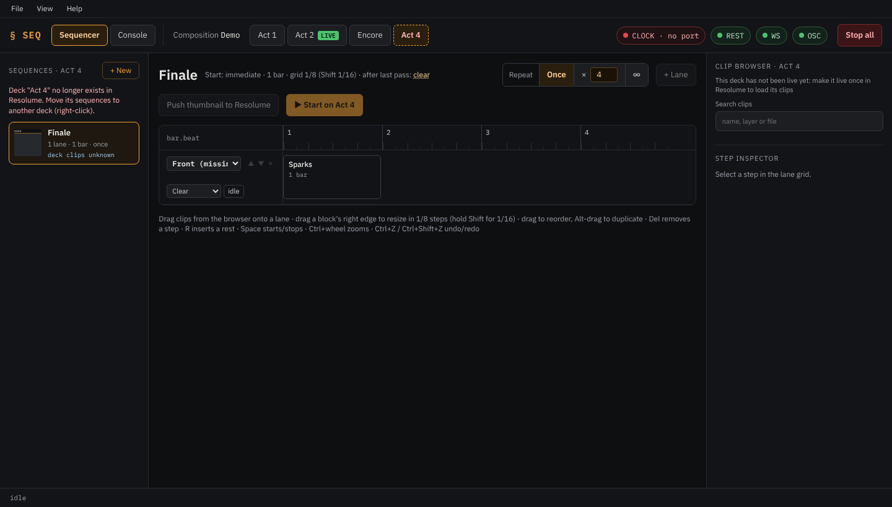

# Working with decks

In Resolume, layers are shared by all decks, while columns and clips belong to one deck. The sequencer follows
that: **every sequence belongs to one deck** and only uses clips of that deck. Its lanes name layers, which exist
in every deck.

## Viewing a deck

The deck tabs on the top bar choose which deck's sequences, clips and editor you see. **LIVE** marks the deck
Resolume is playing. Looking at another deck **never** switches Resolume; you can edit the sequences of the next
act while the current one plays.

Resolume only tells the sequencer about the clips of the **live** deck. The sequencer keeps a copy of each deck's
clips from the last time it was live, so its sequences show and resolve when it isn't. A deck that has never been
live since you started using the sequencer shows no clips ("This deck has not been live yet"): make it live once
in Resolume.

**Before a show, make every deck you'll use live once**, so its clips are cached (they stay cached after a
restart of the app).

## Starting a sequence of another deck

The start button of a sequence on a deck that isn't live reads **▶ Start on *deck***. Starting it:

1. If anything is running, the app asks first: "Switch deck and start?", naming what is running.
2. All running sequences stop (their layers are cleared or held, as each one is set).
3. The sequencer switches Resolume to that deck and waits until Resolume confirms it (the button shows
   "switching…").
4. The sequence starts.

If Resolume doesn't confirm the switch within two seconds, nothing starts and a notice tells you so.

## When Resolume switches decks

If the deck changes in Resolume (you clicked another deck, or a controller did), all running sequences stop
**without clearing** anything: the layers now belong to the new deck, and clearing them would cut what you just
started there. The LIVE badge moves; the deck you are viewing stays.

## Renamed and deleted decks

Sequences are stored by deck **name**. If you rename a deck in Resolume, or delete it, its sequences have no deck
any more. They stay in the file and appear under a dashed tab with the old name, as **orphaned**:

Right-click such a sequence and pick **Move to deck → *name*** to give it a deck again. Orphaned sequences can't be
started.

Two decks with the **same name** share their sequences; the tab shows "same name". Rename one in Resolume to keep
them apart.
