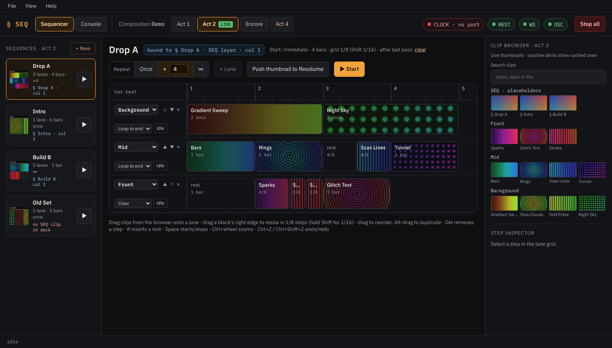
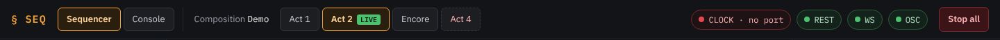
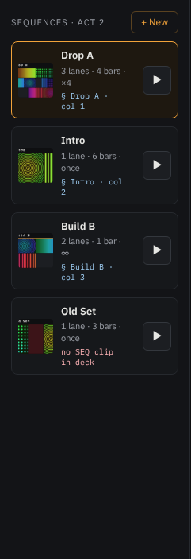
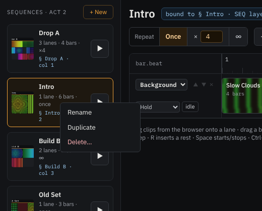
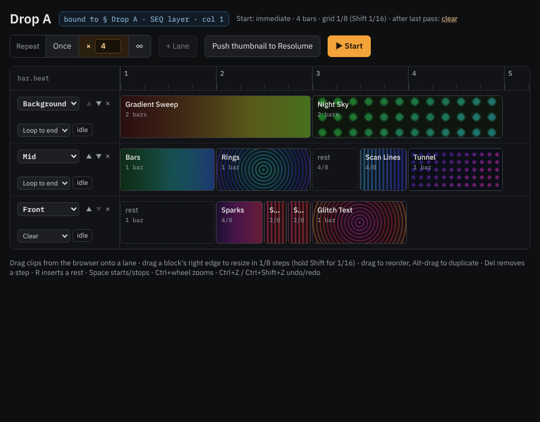
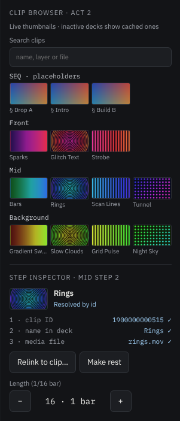
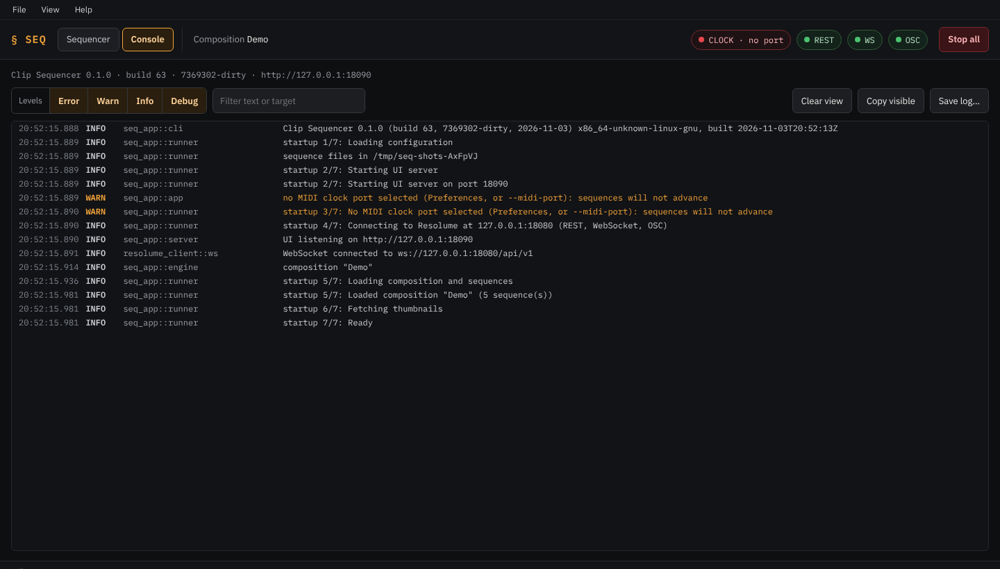

# The interface

The window has a top bar, the sequence list on the left, the editor in the middle, the clip browser and step
inspector on the right, and a status bar at the bottom.

## Top bar

- **§ SEQ** and the tabs **Sequencer | Console** (Ctrl+1 / Ctrl+2). The Console tab shows the log; a red number on
  it counts new errors.
- **Composition**: the name of the composition open in Resolume. Sequences are saved per composition.
- **Deck tabs**: one per Resolume deck. The tab you select is the deck shown below; **LIVE** marks the deck
  Resolume is playing. Selecting a tab never switches Resolume ([Working with decks](decks.md)). A dashed tab is a
  deck that no longer exists in Resolume but still has sequences; "same name" marks two decks with one name.
- **Connection chips**: **CLOCK** (MIDI clock, with BPM), **REST**, **WS** and **OSC** (Resolume). Green is fine,
  red needs attention ([Troubleshooting](troubleshooting.md)). Click the CLOCK chip to choose the MIDI input.
- **Stop all** stops every running sequence and clears every layer the sequencer is using.

## Menus

The **desktop app** has a menu bar in the window frame:

- **File:** Reload composition (read the composition from Resolume again), Save now, Open data folder,
  Preferences… (MIDI clock input), Install FFGL plugin… ([Installing the FFGL plugin](ffgl-plugin.md)),
  Quit (Ctrl+Q).
- **View:** Zoom in / out / reset (Ctrl+= / Ctrl+- / Ctrl+0), Toggle Console.
- **Help:** Keyboard shortcuts, User manual, Report an issue, Licenses, About.

In the **browser** (headless mode, see [Settings](settings.md)) the page has its own menu bar with the same
items, except *Open data folder*; *Quit server…* stops the sequencer after asking. Press **Alt** or **F10** to
reach it with the keyboard.

## Sequence list

The sequences of the deck shown. Each card has:

- the sequence's **mosaic** (its clips in miniature, one row per lane);
- its **name**, a **RUN** badge while it plays;
- lanes, length in bars, and repeat (`once`, `×4`, `∞`);
- its **placeholder** on the SEQ layer (`§ Drop A · col 1`), or in red "no SEQ clip in deck";
- **▶ / ■** to start and stop it.

Click a card to edit the sequence. **+ New** adds a sequence to the deck shown. Right-click a card for **Rename**,
**Duplicate** and **Delete…**; a double-click on the name renames it too.

## Editor

**Header:** the name; the placeholder it is bound to (`bound to § Drop A · SEQ layer · col 1`, or a red note that
there is none); start, length, grid and what happens after the last pass (click *clear* / *hold* to switch).
While the sequence runs and you edit it, an **edited · applies at next start** badge appears.

Below: **Repeat** (Once / × with a number / ∞), the pass counter while it runs, **+ Lane**,
**Push thumbnail to Resolume** ([Thumbnails](thumbnails.md)) and **▶ Start / ■ Stop**.

**Lanes.** Each lane has a head on the left:

- the **layer** it plays on (only named layers of the deck; [Setting up Resolume](resolume-setup.md));
- **▲ ▼** to reorder lanes (display only) and **×** to delete the lane;
- the **end behaviour** for when the lane is shorter than the sequence: *Loop to end* (start the lane's steps
  again), *Hold* (keep the last clip playing), *Clear* (clear the layer and stay silent);
- the lane's **state**: `idle`, `playing`, or `yielded` with **Resume lane** ([Playing live](playing-live.md)).

The **ruler** numbers the bars, with eighth (and, zoomed in, sixteenth) ticks. Zoom with **Ctrl+mouse wheel** over
the grid.

**Steps** are blocks as wide as their length, with the clip's thumbnail:

| Look | Meaning |
|---|---|
| clip thumbnail | a clip step |
| dashed, "rest" | a rest: clears the layer at its start |
| red, "unresolved" | the clip can't be found in the deck; nothing is triggered ([Troubleshooting](troubleshooting.md)) |
| accent outline | selected |
| ⚠ | the clip was found on another layer than the lane's; it plays there |
| accent top edge | playing now |
| red top edge | "not confirmed": Resolume didn't report the clip as playing |

Editing: drag clips from the browser onto a lane; drag a step's **right edge** to resize (1/8 grid, **Shift** for
1/16); drag a step to move it within the lane, **Alt+drag** to copy it; **Del** removes the selected step, **R**
inserts a one-bar rest after it; **Ctrl+Z** / **Ctrl+Shift+Z** undo and redo. All changes are saved automatically.

## Clip browser and step inspector

The **clip browser** lists the clips of the deck shown, one row per layer, top layer first as in Resolume, with
the SEQ placeholders on top. Type in **Search clips** to filter by name, layer or file. Drag a clip onto a lane to
use it. Decks that aren't live show the clips cached from the last time they were live.

The **step inspector** shows the selected step:

- the clip and how it was found: **1 · clip ID**, **2 · name in deck**, **3 · media file**, each with ✓ or ✕
  ([Files and data](files.md) explains the order);
- **Relink to clip…**: then click a clip in the browser to use it for this step (Esc cancels);
- **Make rest**;
- **Length** in sixteenths, with − / +, and the length in bars.

## Status bar

The bottom line shows what is playing and where (`bar.beat`), the last trigger sent to Resolume and its
confirmation, and notices: a lane that yielded, a failed trigger, a problem with a file.

## Console tab

The log of the app, live: time, level, source and message. Filter by level (**Error**, **Warn**, **Info**,
**Debug**) and by text. Scrolling up pauses the view ("paused · N new"; click to continue). **Clear view**,
**Copy visible**, **Save log…** (today's log file), and in the desktop app **Open logs folder**. Attach the log to
a bug report ([Troubleshooting](troubleshooting.md)).

