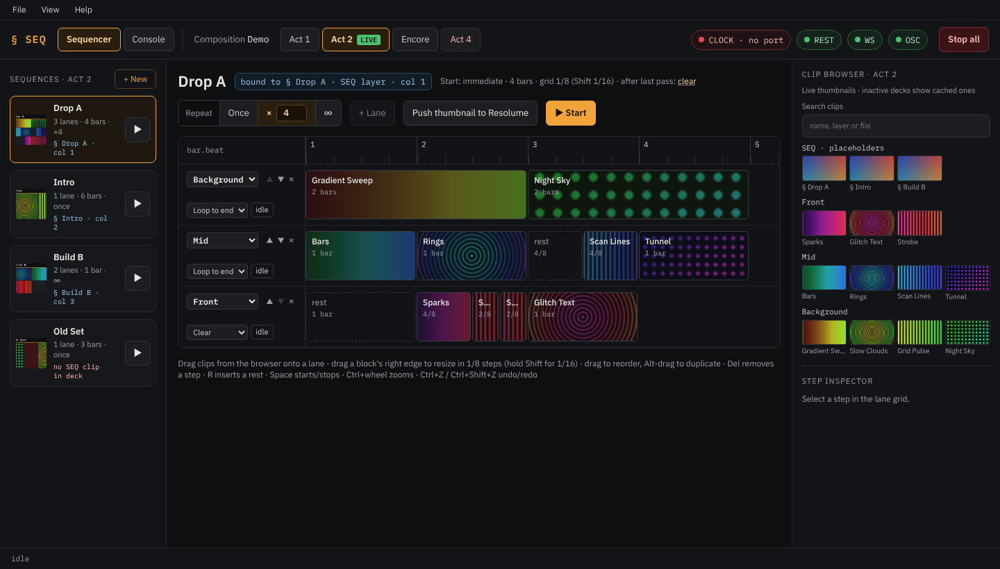

# Introduction

**Clip Sequencer for Resolume** plays sequences of clips in Resolume Arena, locked to your show's MIDI clock.

A **sequence** is a short arrangement: on each Resolume layer it uses (a **lane**), clips and rests follow each
other on a 1/16-bar grid. You might build "Drop A": a background clip for two bars, then another; on the middle
layer a different clip every bar; on the front layer a few short hits. When the sequence starts, the sequencer
triggers every clip exactly on its beat, on all layers at once, for as many passes as you set.



You build sequences in the app and start them either from the app or **from Resolume itself**, by clicking a
placeholder clip. During the show you keep working in Resolume as usual: clicking a clip by hand on a layer a
sequence uses simply takes that layer over until you hand it back.

## How it fits with Resolume

```text
MIDI clock source ──► Resolume      (tempo, BPM sync)
                 └──► Clip Sequencer (counts the clock)

Clip Sequencer ──OSC──────► Resolume   triggers the clips, on the tick
Clip Sequencer ◄─WebSocket─ Resolume   what is playing, deck changes, renames
Clip Sequencer ──REST─────► Resolume   the composition, thumbnails
```

- The sequencer **does not generate a clock**. It follows a MIDI clock that you feed to it and, normally, to
  Resolume as well, so both run at the same tempo.
- It triggers clips over Resolume's **OSC** input and watches Resolume over its **webserver** (WebSocket and REST).
  Both run on the same computer.
- Sequences are saved per composition, grouped by deck, in the app's data folder.

## What you need

- Windows 10 or 11, on the same computer as Resolume.
- Resolume Arena 7.26 or newer, with its webserver and OSC input switched on
  ([Setting up Resolume](resolume-setup.md)).
- A MIDI clock on a MIDI input of that computer ([Setting up the clock](clock.md)).
- For the desktop app: the Microsoft Edge WebView2 Runtime, which is part of Windows 11
  ([Installation](installation.md)).

You should know your way around Resolume: compositions, decks, layers, columns and clips. This manual explains the
sequencer, not Resolume.

## Where to go next

New here? Work through [Installation](installation.md), [Setting up Resolume](resolume-setup.md),
[Setting up the clock](clock.md) and the [Quick start](quick-start.md). Before a show, read
[Playing live](playing-live.md).
