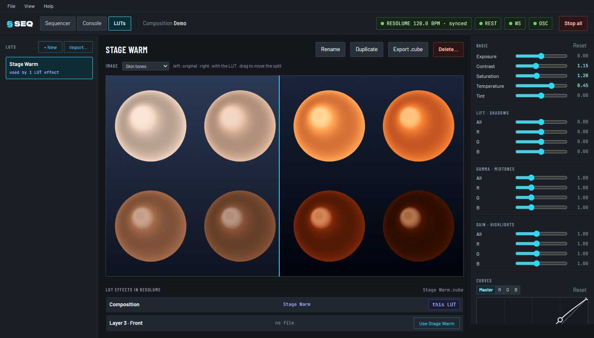
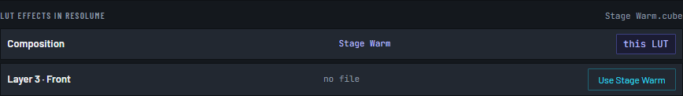
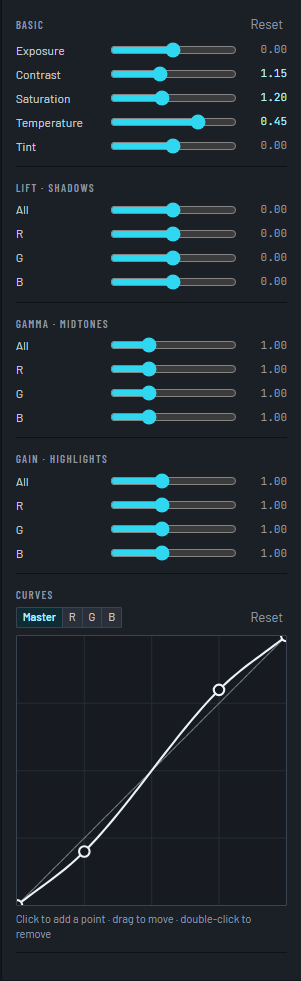

# Colour LUTs

A **LUT** (lookup table) changes the colours of a picture: warmer, cooler, more contrast, a look for the set, or a
correction for a projector or LED wall that shows colours off. The **LUTs** tab is a small LUT editor. Resolume
applies the LUTs with its own **LUT** effect, and every change you make shows on the output while you drag.

## How it fits together

- The sequencer keeps a **library** of named LUTs. Each one is saved as a `.cube` file in the app's data folder
  (`luts\`).
- In Resolume you add the built-in **LUT** effect where the LUT should apply: on the **composition** (the whole
  output, the usual place for projector or LED correction), on a **layer**, or on a **clip**.
- The effect's **LUT 3D** field points at one of the library's `.cube` files. Several effects can use the same
  LUT.
- When you change a LUT in the sequencer, it rewrites the file, and Resolume reloads it by itself, within a
  moment. Every effect that uses that LUT changes.
- The link lives in Resolume: it saves the file path with the composition. The LUTs keep working when the sequencer
  is closed.

## Your first LUT

1. Open the **LUTs** tab (or press **Ctrl+3**).
2. Click **+ New**. A neutral LUT called *New LUT* appears: it changes nothing yet. Double-click its name to
   rename it, for example to *Stage Warm*.
3. Move the controls on the right. The preview shows the original left of the line and the LUT right of it; drag
   in the picture to move the line. Under **Image** you can pick a test image or one of your clips (the live deck's
   thumbnails).
4. In Resolume, add the **LUT** effect to the composition (or a layer or clip). It appears in the sequencer under
   **LUT effects in Resolume**.
5. Click **Use Stage Warm** next to it. The effect now uses your LUT; keep adjusting and watch the output.

You can also choose the file in Resolume yourself: click the effect's **LUT 3D** field and pick the `.cube` from
the sequencer's `luts` folder (its path shows above the list).

## The controls

| Control | What it does |
|---|---|
| **Exposure** | Brighter or darker, in stops (+1 doubles the light). |
| **Contrast** | More or less difference between dark and bright, around mid grey. |
| **Saturation** | Colour strength: 0 is black and white, 1 unchanged. |
| **Temperature** | Cooler (blue) to warmer (orange). |
| **Tint** | Green to magenta. |
| **Lift** | Raises or lowers the shadows; per colour it tints them. |
| **Gamma** | Moves the midtones; per colour it tints them. |
| **Gain** | Scales the highlights; per colour it balances white (useful for LED walls). |
| **Curves** | Master, R, G and B. Click to add a point, drag it, double-click to remove it. |

*All* changes the three colours together; **R**, **G** and **B** change one. Double-click a slider to reset it;
**Reset** next to *Basic* resets all sliders (the curves stay), **Reset** next to the curves resets the curve
shown. The order is fixed: the sliders first, then the curves.

## Importing and exporting

- **Import…** loads `.cube` files, several at once (3D and 1D LUTs). Each becomes a library LUT named after its
  file, marked *imported*. The sliders and curves then work on top of it; **remove base** drops the imported table.
- **Export .cube** saves a LUT for other programs.

## Renaming, duplicating, deleting

- **Rename** (or double-click the name): the file is renamed, and the sequencer points the LUT effects that used
  it at the new file.
- **Duplicate** makes a copy to try a variation.
- **Delete…** asks first and tells you if LUT effects in Resolume use it. They keep their path to a file that is
  gone, so give them another LUT first.

## Good to know

- Changes are saved at once; there is no Save button and no undo. Duplicate a LUT before big changes.
- While you drag, the file is written at most ten times a second; the last value always ends up in it.
- The preview uses the same table as Resolume, so what you see in the sequencer is what Resolume shows (Resolume
  may apply effects after the LUT that change it).
- LUT effects inside layer groups aren't listed yet; choose the file in Resolume for those.
