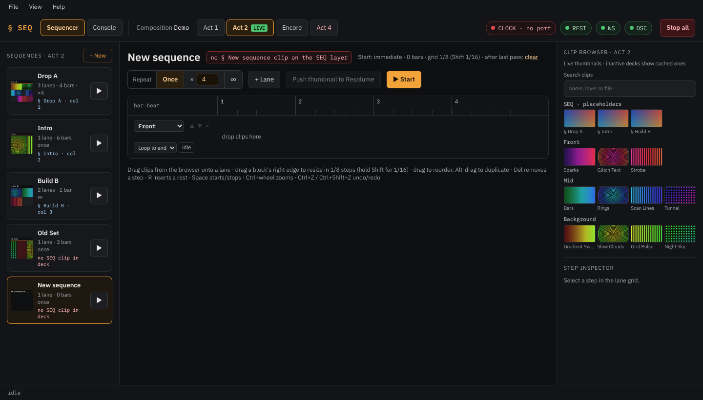
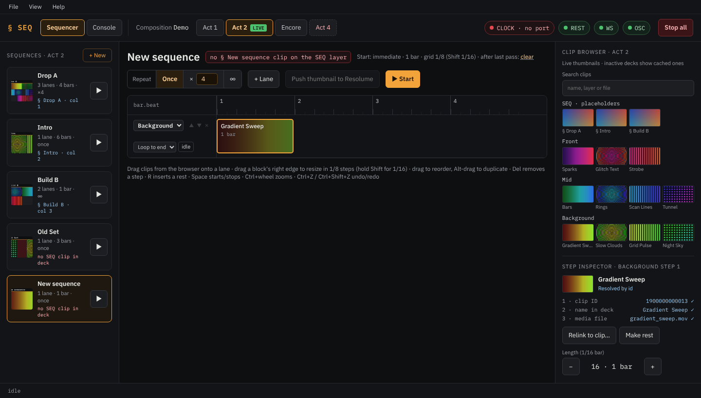
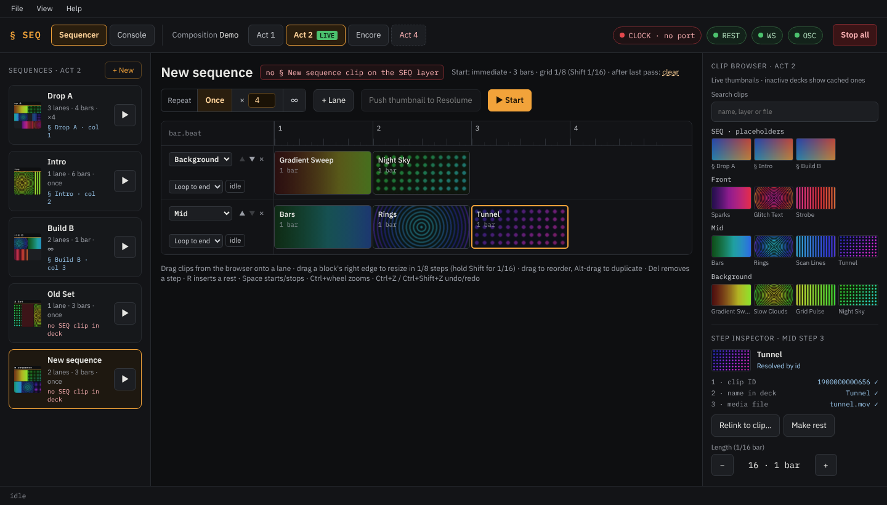
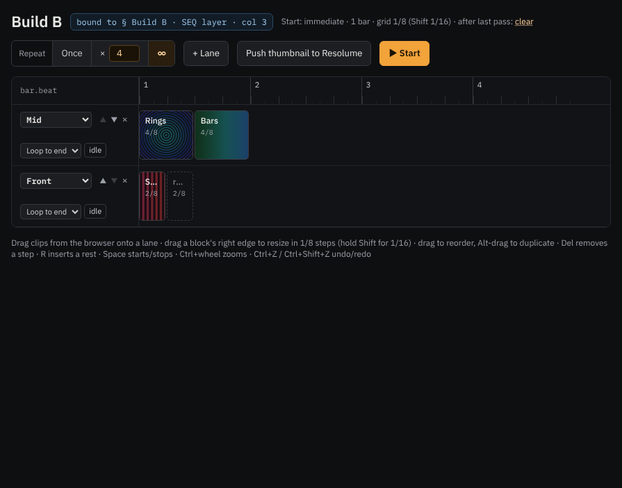

# Quick start

This walk-through builds a two-lane sequence and starts it, first from the app, then from Resolume. It assumes
Resolume runs with the webserver and OSC switched on, your layers have names, and a MIDI clock is selected
([Setting up Resolume](resolume-setup.md), [Setting up the clock](clock.md)).

The screenshots use a demo show with the layers `Background`, `Mid` and `Front`; use your own layers and clips.

## 1. Create a sequence

Make sure the deck you want is shown: the deck tabs on the top bar, with **LIVE** on the deck Resolume plays. Click
**+ New** above the sequence list. A sequence named "New sequence" appears, with one empty lane.

Double-click its name in the list (or right-click → **Rename**) to give it a real name, for example `Drop B`.

## 2. Add clips to the first lane

1. Choose the lane's layer in the lane head on the left (here `Background`).
2. Drag a clip from the **clip browser** on the right onto the lane. It becomes a step, one bar long.

3. Drag a second clip behind it. Clips you drop between two steps are inserted there.

To change a step's length, drag its right edge: it snaps to eighths of a bar, or to sixteenths while you hold
**Shift**. The step inspector (bottom right) shows the length and has − / + buttons.

## 3. Add a second lane

Click **+ Lane**, choose its layer (here `Mid`), and drag clips onto it. Lanes can have different lengths: the
sequence lasts as long as its longest lane, and a shorter lane loops, holds or goes silent until the end (the
*end behaviour* under the layer name).

A rest is a gap that clears the layer: select a step and press **R** to insert a one-bar rest after it, or click
**Make rest** in the step inspector to turn a step into one.

## 4. Choose how often it plays

Use **Repeat** in the editor's header: **Once**, **×** with a number, or **∞** (until you stop it). After the last
pass the sequence clears its layers; click "after last pass: **clear**" in the header to switch to **hold**
(the last clips keep playing).

Everything is saved automatically a moment after each change.

## 5. Start it from the app

Click **▶ Start** in the editor (or ▶ on the sequence's card, or press **Space**). The clips start on the next
tick of the clock, on both layers at once; a playhead moves along the lanes. Click **■ Stop** (or Space again) to
stop it, or **Stop all** on the top bar to stop everything.

If the sequence belongs to a deck that isn't live, the button reads "Start on *deck*": the sequencer asks first,
switches Resolume to that deck, then starts ([Working with decks](decks.md)).

## 6. Start it from Resolume

1. In Resolume, on the `SEQ` layer, add a clip with the *Blank* source and name it `§ Drop B`.
2. In the app, the sequence's card now shows `§ Drop B · col N` instead of the red "no SEQ clip in deck".
3. Click the `§ Drop B` clip in Resolume: the sequence starts. Clear the SEQ layer to stop it.

Next: [The interface](interface.md) explains every part of the window, [Playing live](playing-live.md) what
happens during a show.
