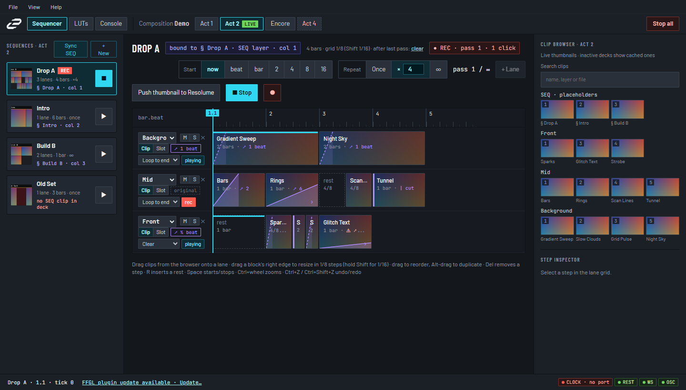

# Recording from Resolume

Build a pattern by playing it: arm a sequence, start it, and click clips in Resolume in time. What you click lands
on the grid, and the next pass plays it back, so you can build a pattern up pass by pass: one layer in the first
pass, the next layer in the second while the first one plays back, and so on.

## Recording

1. Select a sequence of the **live** deck and click **⏺** in the editor header. It shows `● armed`. A sequence
   without steps asks for the **pattern length** first (1 to 16 bars).
2. Start it (▶ or Space). It starts as usual, by its start mode: a bar start gives you a count-in. While it records
   it shows `● REC · pass 1` and loops pass after pass, whatever its repeat setting.
3. Click clips in Resolume, or press a layer's **Clear** button for a rest, in time with the music.
4. What you play appears in the sequence at once, and the next pass plays it.
5. **Stop** (or **⏺** again) ends the recording.

Each pass is **one undo step**: **Ctrl+Z** removes the last pass you recorded.

For clicks to land where you play them, the sequence's grid must be lined up with the music: with Resolume's
tempo as the clock, press **Resync** in Resolume on a bar's first beat, and give the sequence a **bar** start
mode rather than *now*. A chip next to the REC tag says `in sync` when it is, `⚠ not synced` or `⚠ starts now`
when it isn't. While the start waits for its bar, the tag counts the beats down: `● REC in 3`.

## What gets recorded

- Every click lands on the **nearest sixteenth**. A click just before the end of a pass belongs to the start of
  the next one.
- A click is **punched in**: it replaces its lane from where you clicked up to the next step that was already
  there (or your next click on that layer). Everything else stays: a clip clicked between two others keeps the
  later ones.
- The lanes keep playing while you record, also the one you play on.
- A click on a layer that has **no lane** in the sequence adds a lane for it. The layer needs a unique name
  ([Setting up Resolume](resolume-setup.md)); the SEQ layer is never recorded.
- **Slot lanes** record the **column** you clicked, clip lanes the clip.
- **Transitions:** each step gets the transition Resolume used for your click: the layer's, or the clip's own if
  the clip isn't *Layer Determined*. The length is turned into beats at the current tempo. Change the layer's
  transition in Resolume while you record to play fades ([Transitions](transitions.md)). A lane you play without
  fades stays a lane without transitions.

## Across the loop

A clip you start near the end of a pass that is still playing when the pass ends goes on into the next pass: it is
recorded at the start of the next pass as a **tied** step (`⌒`), up to the next step there, so it isn't
restarted at bar 1. The same goes for a Piano clip you hold over the end of the pass.

## Limits

- Clips in **Piano** trigger style record as you play them: the clip from press to release, then a rest. While
  you hold one, it **overwrites** whatever the lane had in that time, and the lane stays quiet; after you let go,
  the lane plays again from its next step. A quick tap records at least a sixteenth. **Toggle** clips record a rest when you click them off.
- Clicking the clip that is already playing does nothing in Resolume, so it can't be recorded: the step just
  goes on.
- A layer's **Clear** with a fade is reported only when the fade has ended; the sequencer places it one fade
  earlier, so it lands where you pressed it.
- Only one sequence records at a time.
