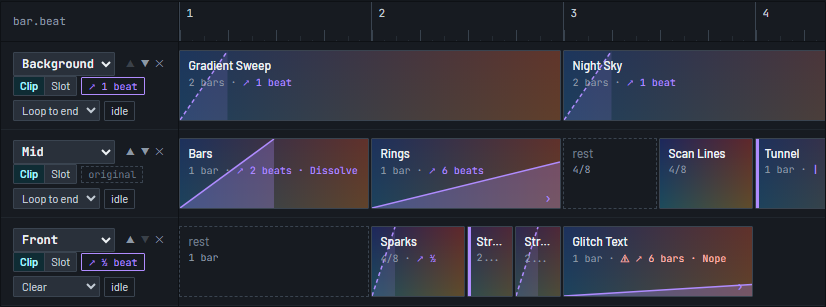
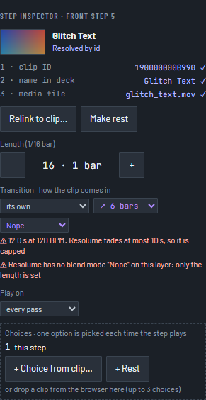

# Transitions

A step can say **how its clip comes in**: a fade over some beats, optionally with a blend mode such as *Dissolve*
or *Wipe Ellipse*. A lane can have a **default** that its steps use unless they have their own.

The sequencer uses the **layer transition** in Resolume for this (the *Transition* settings of the layer): just
before a step starts, it sets the layer's transition to the step's. When the sequence lets go of the layer, the
layer gets back the transition it had before. You never have to clean up after it.

## Setting a transition

- **Lane default:** click the chip next to **Clip | Slot** in the lane head (`↗ none` when the lane has no
  transitions, `↗ original` when only some steps have one). Choose a length and, if you like, a blend mode. Steps without their own transition use it.
- **One step:** select it and use **Transition** in the step inspector: *its own*, then a length and a blend mode.
  Back to the lane's with the first list.
- Lengths are in beats and bars (¼ beat … 4 bars), or **cut** (no fade).
- The blend mode list is the layer's own list from Resolume. *layer's blend* keeps the blend mode the layer had
  before the sequence started.

## What you see on a step

- A **wedge** at the left edge, rising to the right. It is drawn on the grid: a 1-beat fade covers the first beat
  of the block.
- **Solid** for the step's own transition, **dashed** for one it takes from the lane default.
- A **bar** at the left edge for a step set to **cut**.
- A small **›** when the fade is longer than the step: the next step starts while it still runs.
- The label in the length line: `↗ 1 beat · Dissolve`, in narrow blocks `↗ 1`.
- Steps that get the layer's original transition, or Resolume's own, show nothing.

## Which transition a step gets

1. Its own, if it has one.
2. Otherwise the lane default.
3. Otherwise, if any step of the lane has a transition: the transition the layer had **before** the sequence
   started (so a step without one always looks the same, whatever played before it).
4. A lane without any transition never touches the layer's transition: Resolume's own setting applies.

## How it plays

- The fade length follows the tempo: 1 beat is 0.5 s at 120 BPM and 0.47 s at 128 BPM. When the tempo changes
  while a sequence runs, the sequencer sends the new length, and a fade that is running keeps its beat.
- Resolume fades for at most **10 seconds**. A longer fade is cut to 10 s, and the step shows ⚠.
- With **choices**, the step's transition applies to whichever option is picked. A step that doesn't play on this
  pass sets nothing.
- **Stopping** (a sequence ending, Stop, Stop all, another deck) gives the layer its original transition back
  **first**, then clears the layer. So stopping looks as it did before: usually a cut. A lane that ends with
  **Clear** does the same.
- A sequence that takes a layer from another one keeps the original of the first; a sequence **without**
  transitions that takes the layer gives it back its original.
- **You win:** if you change the layer's transition in Resolume while a sequence holds the layer, the sequencer
  leaves your setting alone when it stops (the log says so). It still sets its steps' transitions while it runs.
- If the app quits or crashes while a sequence holds a layer, the originals are kept in
  `transitions-pending.json` in the data folder and restored the next time that composition is open.

## Warnings

A step's label turns red with ⚠, and the step inspector says why, when:

- the fade is longer than 10 seconds at the current tempo (it is capped);
- the blend mode isn't one Resolume has on this layer (for example from another composition): only the length is
  set;
- the clip has its **own** transition in Resolume (its *Transition* is not *Layer Determined*): Resolume then
  ignores the layer's transition for that clip. Set the clip's transition back to *Layer Determined* in Resolume.

The log shows each restore: `transition on BG restored (0.0 s, Alpha)`. With **Log debug messages** on
(Preferences → Log), every value sent is logged too.
